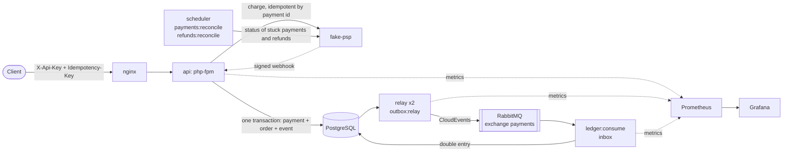
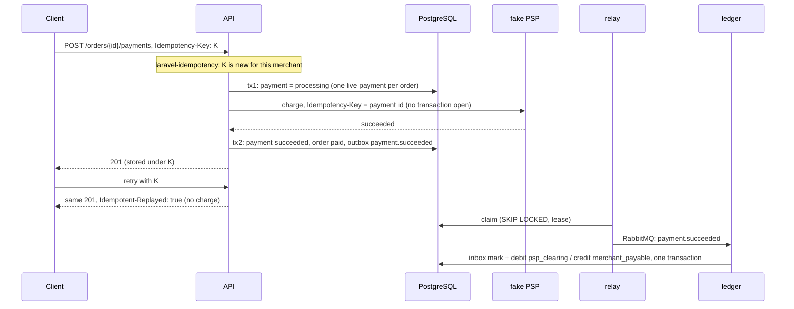
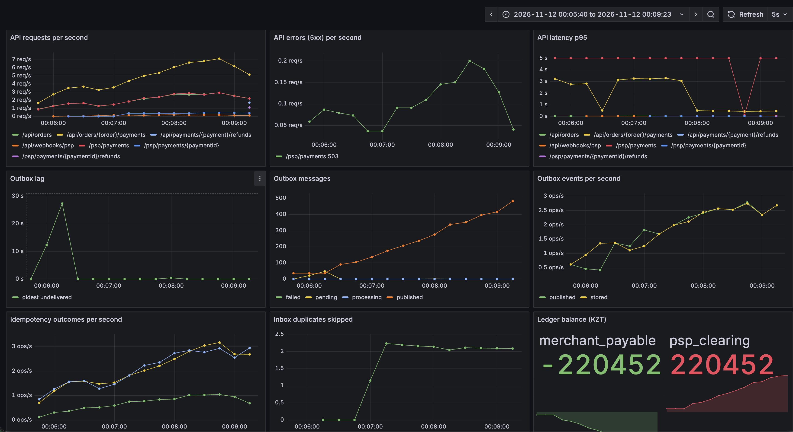

# payments-outbox

[](https://github.com/azhimov/payments-outbox/actions/workflows/ci.yml)
[](LICENSE)

A demo payments service for the fictional **Demo Store**. It shows [azhimov/laravel-idempotency](https://github.com/azhimov/laravel-idempotency) and [azhimov/laravel-outbox](https://github.com/azhimov/laravel-outbox) working together, and **proves** what they promise.

Clients retry, the PSP times out, the relay is killed and RabbitMQ restarts. Even so, no customer is charged twice and no event is lost. `make chaos` breaks all of that on purpose and then reconciles every payment against the PSP and the ledger.

## The problem

Two failures cost money in every payment system:

- **Double charge.** The client sends `POST /payments`, the money is taken, the response is lost. The client retries and pays again. A different idempotency key, a double click or a timeout at the PSP lead to the same place.
- **Lost or duplicated events.** The service marks the order paid and publishes `payment.succeeded`. If the process dies in between, accounting never hears about the money. If the broker delivers twice, accounting books it twice.

## Architecture



One Laravel 13 / PHP 8.4 application, Clean Architecture:

```text
app/
  Domain/          Order, Payment (state machine), Money, ledger transactions. Plain PHP (checked by a PHPStan rule)
  Application/     use cases (CreateOrder, CreatePayment, PaymentOutcomes, HandlePspWebhook, ReconcilePayments, RefundPayment, RecordLedgerEntries) and ports
  Infrastructure/  Eloquent repositories, HTTP payment gateway, outbox / inbox wiring, RabbitMQ consumer, metrics
  Presentation/    controllers, form requests, resources, middleware, artisan commands
  FakePsp/         the pretend acquirer, served by its own container
```

### A payment, step by step



If the PSP times out, the outcome is unknown. The payment stays `processing`, the client gets `202`, and either the webhook or `payments:reconcile` finishes it. Both go through the same `PaymentOutcomes`, so whichever arrives second does nothing.

## Run it

```bash
docker compose up --build -d --wait     # api, nginx, fake-psp, relay x2, ledger, scheduler, postgres, redis, rabbitmq, prometheus, grafana, swagger-ui
```

| | |
|---|---|
| API | http://localhost:8080 (`APP_PORT` to change); demo key `demo-store-key` |
| Swagger UI | http://localhost:8082 (OpenAPI 3.1 in [docs/openapi.yaml](docs/openapi.yaml)) |
| Grafana | http://localhost:3000, dashboard "Payments" |
| RabbitMQ | http://localhost:15672 (guest / guest) |
| Prometheus | http://localhost:9090 |

Create an order and pay it twice with the same key:

```bash
curl -s -X POST localhost:8080/api/orders -H 'X-Api-Key: demo-store-key' -H 'Content-Type: application/json' \
  -d '{"currency":"KZT","items":[{"sku":"SKU-TEA","name":"Green tea","quantity":2,"unit_price":150000}]}'
```
```json
{"data":{"id":"01a1cb2c-e399-732a-9365-3566ade3962a","status":"pending","currency":"KZT","total_amount":300000,"items":[{"sku":"SKU-TEA","name":"Green tea","quantity":2,"unit_price":150000}]}}
```
```bash
curl -i -X POST localhost:8080/api/orders/01a1cb2c-e399-732a-9365-3566ade3962a/payments \
  -H 'X-Api-Key: demo-store-key' -H 'Content-Type: application/json' -H 'Idempotency-Key: demo-key-1' \
  -d '{"card_token":"tok_success"}'
```
```http
HTTP/1.1 201 Created

{"data":{"id":"01a1cb2c-e42e-725c-bc8c-1832c52f0b63","order_id":"01a1cb2c-e399-732a-9365-3566ade3962a","status":"succeeded","amount":300000,"currency":"KZT","refunded_amount":0,"failure_reason":null}}
```

The same request again returns `201 Created` with `Idempotent-Replayed: true` and the same body. The PSP is not called.

Amounts are integers in tiyn (minor units). Card tokens of the fake PSP:

| Token | Outcome |
|---|---|
| `tok_success` | succeeded |
| `tok_decline` | declined |
| `tok_pending` | `202` processing, final status by webhook a moment later |
| `tok_timeout` | charged, but the answer comes too late: `202`, then reconcile |
| `tok_error` | `503`, not charged: `202`, then reconcile marks it failed |
| `tok_visa` | random, by `FAKE_PSP_*_RATE` |

Refund: `POST /api/payments/{id}/refunds` with `{"amount": 100000}` and an `Idempotency-Key`.

## Proof: `make chaos`

```bash
make chaos              # ORDERS=500 by default; ORDERS=50 runs in CI as chaos-smoke
```

The run goes like this:

1. Starts everything from scratch, with the fake PSP set to **10% timeouts** (charged, answered after the client gave up) and **5% 503s** (not charged).
2. `demo:load` creates the orders and pays each with **1–3 identical requests** under one key. Some race in parallel, and 409 and 5xx answers are retried with the same key. A share of paid orders is then refunded, also with repeats.
3. Mid-run it **kills both relay workers** and **restarts RabbitMQ**, then brings the relay back.
4. `demo:verify` waits until nothing is processing and the outbox is drained, then reconciles three sources of truth: our payments, the **PSP's own charges** and the **ledger**.

Result of a full run on a laptop (`make chaos`, 2026-11-12):

| Input | |
|---|---|
| Orders | 500 |
| Payment requests (1–3 per order, same key, partly parallel, retries) | 1 159 |
| Refund requests (with repeats) | 59 |
| Answers | 1 382 × 201, 199 × 202, 137 × 409 |
| Failures injected | PSP: 10% timeouts, 5% 503; relay killed 1 time; RabbitMQ restarted 1 time |

Every request got one of three answers:

| Code | When | What the client does |
|---|---|---|
| `201` | The order was created (500 of them), or the payment or refund reached a final status: succeeded, declined, failed. A repeat with the same key gets the stored `201` again (`Idempotent-Replayed: true`). | Nothing: the answer is final. |
| `202` | The PSP timed out, answered 503 or said `pending`. The outcome is unknown, so the payment stays `processing` until the webhook or `payments:reconcile` settles it. A repeat with the same key gets the stored `202`. | Reads `GET /api/payments/{id}` later. |
| `409` | `idempotency_request_in_progress`: a parallel repeat with the same key arrived while the first request was still running. | Retries after `Retry-After` with the same key. |

Possible, but absent from this run:

| Code | When | What the client does |
|---|---|---|
| `503` | `psp_unavailable` on a refund when the PSP answer was unclear. Not stored under the key; `refunds:reconcile` finishes the refund. | Retries with the same key. |
| `502` / `504` | `api_unreachable` / `api_timeout` from nginx when php-fpm is gone or silent: the api is restarting, crashed or overloaded. These come in the same JSON error format. The request may or may not have run. | Retries with the same key. |

| Check (`demo:verify`) | Result |
|---|---|
| Orders with more than one captured payment | **0** |
| Orders charged more than once **at the PSP** | **0** |
| PSP charges not captured in payments (money taken, we don't know) | **0** |
| Payments still processing after settling | 0 |
| Refunds still processing after settling | 0 |
| Outbox messages not delivered | 0 |
| Captured payments booked in the ledger | 458 of 458 |
| Refunds booked in the ledger | 39 of 39 |
| Unbalanced ledger transactions | 0 |
| Merchant payable = paid − refunded | 232 320.50 KZT = 232 320.50 KZT |

458 orders paid, 42 declined or failed (declines plus 503s the PSP never charged), and **0 double charges, 0 lost events**. The report is written to `storage/chaos/report.json`.



The Grafana dashboard "Payments" during an earlier 500-order run:
- **Outbox lag.** The hump is the relay kill. Both relay workers are killed and RabbitMQ restarts, so the oldest undelivered event ages to about 27 s. Once the relay is back it drains the backlog, and the lag returns to 0 within seconds and stays there.
- **Outbox messages.** Nothing ends up `failed`.
- **API errors (5xx).** Only the 503s injected at the fake PSP show up here.
- **Inbox duplicates skipped.** Redeliveries the ledger ignored.
- **Ledger balance.** `merchant_payable` and `psp_clearing` mirror each other.

## Why it's built this way

- **Outbox instead of dual write.** `payment.succeeded` is written in the same transaction as the payment and the order, and the relay delivers it later. A crash can delay the event, never lose it, never send it for a rolled-back payment.
- **The PSP call is outside every transaction.** Holding a row lock during a 3-second HTTP call would serialize the whole service. So it is tx1 (processing), the call, then tx2 (outcome). A crash between them leaves a `processing` payment that reconcile closes.
- **Unknown is not failed.** On a timeout or 5xx the money may have been taken. Calling it `failed` invites a retry with a new key and a real double charge. It stays `processing` until the PSP says what happened.
- **Idempotency at three layers.** The client's key is scoped per merchant (laravel-idempotency). Our payment id is the PSP's idempotency key. A partial unique index allows one live payment per order, whatever key the client sends.
- **Inbox on every consumer.** PSP webhooks are deduplicated by event id. The ledger is deduplicated by message id, with the mark in the same transaction as the entries. At-least-once delivery becomes effectively-once processing.
- **Integer money, double entry.** Amounts are integers in minor units. Each event is a balanced pair of entries (`psp_clearing` / `merchant_payable`), and refunds are reverse entries, never edits.
- **Per-merchant scope everywhere.** API keys (stored as sha256), idempotency keys and every read are scoped to the merchant.

## Limitations

- **Stuck payments and refunds are closed by reconcile** (`payments:reconcile`, `refunds:reconcile`) every minute, once they have been processing longer than `PSP_RECONCILE_AFTER` (60 s). Until then the client sees `202` / `processing`.
- **A retry gets the stored response.** A `202` replayed by laravel-idempotency still says `processing` after the payment finished. Read `GET /api/payments/{id}` for the current status.
- **A refund with an unclear PSP answer** returns `503` and keeps its amount reserved until it is resolved. A retry with the same key completes it (the refund id is derived from the key), or `refunds:reconcile` does it within about a minute. Both go through one idempotent `RefundOutcomes`, so the refund happens once whichever comes first.
- **The fake PSP shares the database** so `demo:verify` can count real charges. A real provider would be reconciled from its reports instead.
- **Demo security.** The demo API key and webhook secret are public on purpose, and `/metrics` is open inside the compose network.

## Tests

```bash
make check                 # Pint, Larastan max (with a PHPStan rule keeping Domain framework-free), Pest on SQLite
docker compose up -d --wait postgres rabbitmq
make test-pgsql            # the whole suite on PostgreSQL + RabbitMQ, in their own database and vhost
```

The suite covers the following:
- every allowed and forbidden payment transition;
- each endpoint, including the replay, the 422 for a different body and the 409 for a concurrent request;
- rollback of payment + order + event together;
- webhooks: signature, replay window and duplicates;
- webhook vs reconcile and client retry vs refund reconcile, each in both orders;
- the ledger against real RabbitMQ: duplicates, DLQ and retry, SIGTERM;
- the HTTP gateway against the fake PSP running in a real server process;
- `demo:verify` against each kind of violation.

CI also runs the 50-order chaos run.

## Built with

- [azhimov/laravel-idempotency](https://github.com/azhimov/laravel-idempotency): `Idempotency-Key` middleware.
- [azhimov/laravel-outbox](https://github.com/azhimov/laravel-outbox): transactional outbox, parallel relay, inbox, RabbitMQ transport with `receive()`.

## License

MIT, see [LICENSE](LICENSE).
